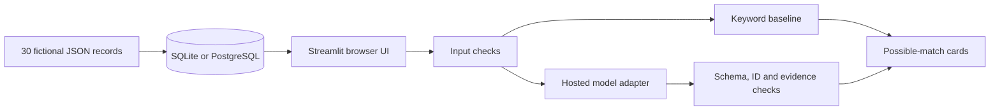

# Architecture

| Component | Responsibility |
|---|---|
| app.py | Forms, mode choice, category filter, catalogue and result presentation |
| lostfound/config.py | Server-only configuration and HTTPS endpoint validation |
| lostfound/database.py | SQLAlchemy connections, schema, idempotent seeding and reads |
| lostfound/matching.py | Input boundaries, overlap baseline, provider request and validation |
| lostfound/models.py | Strict typed record and response contracts |
| data/items.json | Versioned synthetic source data |
| evaluation | Synthetic evaluation fixtures and reproducible report runner |
| scripts/start.py | Database readiness and hosting port configuration |

## Schema v1

`items(id VARCHAR(16) PRIMARY KEY, type VARCHAR(80), colour VARCHAR(60),
features JSON, description VARCHAR(600))`; all columns are required.
The type column is indexed. No personal-data tables or writable public endpoints
are provided.

SQLite lives under the project root by default. PostgreSQL uses psycopg and
SQLAlchemy connection pooling with connection checks. Seeding uses dialect-specific
ON CONFLICT DO NOTHING inside a transaction. It does not truncate or modify
existing records.

## Model contract

The prompt is versioned as grounded-v1. It asks for only a status and up to three
ranked IDs with verbatim evidence excerpts. The system does not display arbitrary
model-written prose. It derives titles from stored records and renders only
escaped database text and verified quotes. More than three IDs, duplicates, missing
IDs, extra response fields, incompatible status/match combinations and unsupported
evidence invalidate the whole result.

Validation proves source provenance, not semantic relevance. A model can quote a
real but irrelevant phrase. Manual evaluation must check contradictory attributes,
unsupported inferences and useful ranking. Results never confirm ownership.

The hosted adapter supports HTTPS Chat Completions-compatible JSON providers.
Requests have a timeout, response-size limit, no redirects, no retries and a
process-level rate budget. Secrets and raw provider diagnostics are not shown in
error messages. No provider is configured or contacted by default.

## Deployment and persistence

Render's free filesystem is ephemeral. This is acceptable only for this fixed,
read-only catalogue, which rebuilds from source; it is not suitable for future
user-posted items. Use managed PostgreSQL or persistent storage before adding
mutations. The current deployment runs one application instance. For scaling,
add explicit migrations and a shared AI rate limiter.

The Docker image runs as an unprivileged user. /_stcore/health is the server
liveness endpoint, not a continuous database readiness probe. The deployment
entrypoint initializes the database before starting the server, so initial DB
errors fail startup instead of claiming a ready application.
